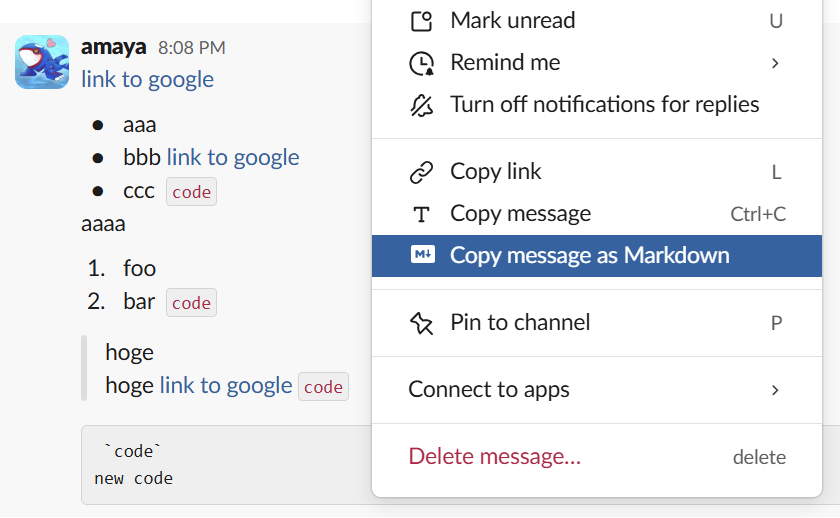
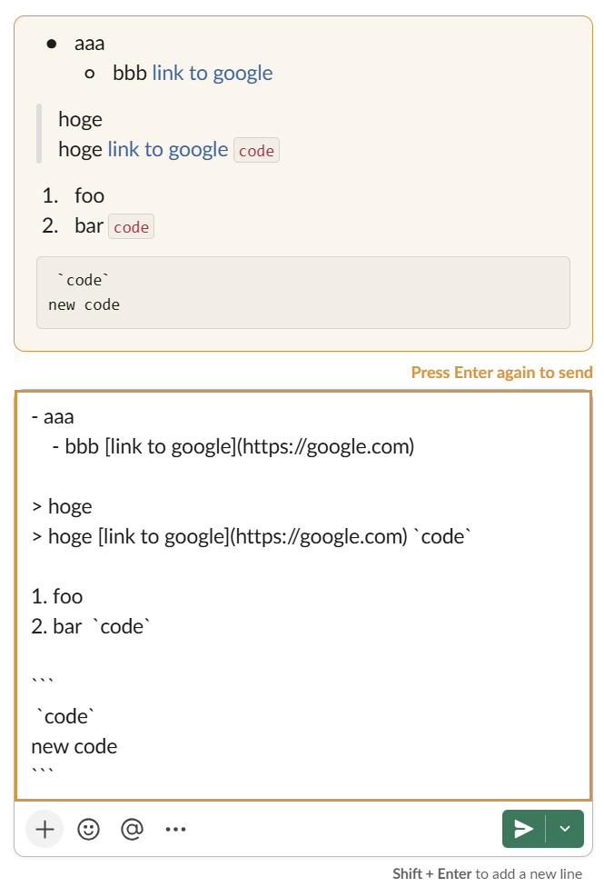

<p align="right"><a href="README.md">English</a> / <strong>日本語</strong></p>

<h1 align="center">💬 Slack Utils</h1>

<p align="center">
  <strong>Chrome で Slack を使うための小さなユーティリティ</strong><br/>
  メッセージを Markdown でコピーし、送信前にメッセージを preview し、Slack のリンクをブラウザで開ける。
</p>

Slack Utils は plain JavaScript で書いた Manifest V3 の Chrome 拡張機能である。ビルドは不要で、リポジトリのディレクトリがそのまま拡張機能になる。

## Why Slack Utils?

- **Slack の画面に組み込む** — コピーのコマンドは Slack のメッセージメニューに並び、preview は入力欄のすぐ上に出る
- **送信後に近い見た目の preview** — preview は Slack 自身の表示用 class で描画し、メンションは入力欄が認識したとおりに表示する
- **小さな機能範囲** — 動くのは Slack のドメインの上だけで、拡張機能から独自に通信することはない

## 🚀 Quick Start

**前提**：デスクトップ版の Chrome と、ブラウザで `https://app.slack.com/` を開いた Slack。Slack のデスクトップアプリには対応しない

1. このリポジトリを clone する

   ```bash
   git clone https://github.com/amaya382/chrome-slack-utils.git
   ```

2. `chrome://extensions/` を開く
3. 「デベロッパー モード」をオンにする
4. 「パッケージ化されていない拡張機能を読み込む」を押し、clone したディレクトリを選ぶ

導入前から開いていた Slack のタブは再読み込みが要る。メッセージを入力して `Enter` を押し、送信されずにオレンジの枠付きの preview が出れば動いている。

更新するときは `git pull` してから、`chrome://extensions/` の拡張機能カードにある再読み込みボタンを押す。

## 📖 Usage

### Markdown でコピー

メッセージにカーソルを合わせると出る ⋮ メニューに「Copy message as Markdown」が加わり、メッセージ全体をコピーできる。テキストを選択しているときは「Copy selected message as Markdown」も現れ、選択した部分だけをコピーする。選択部分のコピーは、Slack のページで右クリックしたときのブラウザのメニューにも「Copy selected as Markdown」として出る。

変換の対象は、太字、斜体、取り消し線、インラインコード、コードブロック、引用、リンク、入れ子を含む箇条書きと番号付きリストとチェックリスト、`:name:` 形式の絵文字である。メンションとチャンネルは `@name` や `#channel` のような平文としてコピーする。コピーできたことは右下のトーストで知らせる。



### Send Preview

入力欄で `Enter` を押すと、送信せずに入力欄の上へ描画済みの preview を出し、入力欄をオレンジの枠で囲む。もう一度 `Enter` を押すか送信ボタンを押すと送信する。`Esc` を押す、メッセージを編集する、入力欄からフォーカスを外す、のいずれかで preview は閉じる。

preview に出るもの：

- メンション、`@here` や `@channel`、チャンネル。手で打ったものも補完で選んだものも、入力欄が認識したとおりに表示する
- `[text](url)`、`<url|text>`、URL そのままの 3 つの書き方のリンク
- 太字、斜体、取り消し線、インラインコード、コードブロック、引用（`>` と `>>>`）、入れ子のリスト、絵文字
- 添付：画像のサムネイル、画像以外のファイルの名前と種類、リンクのプレビュー

`Shift` + `Enter`（改行）、補完のポップアップが開いている間、送信済みメッセージの編集中、空のメッセージでは preview を出さない。



### Open Links in Browser

`https://<workspace>.slack.com/archives/...` のようなメッセージのリンクを開くと、通常は Slack のデスクトップアプリを起動するページと、ブラウザの「Open Slack.app?」ダイアログが出る。拡張機能はそのページを読み込む前にリンクを `https://<workspace>.slack.com/messages/...` へ転送するので、ダイアログを出さずにブラウザの Slack でメッセージが開く。

## ⚙️ Configuration

ツールバーにある拡張機能のアイコンを押すと popup が開く。

| 設定 | 既定値 | 説明 |
| --- | --- | --- |
| Send preview | オン | 1 回目の `Enter` で preview を出す |
| Open links in browser | オン | Slack のメッセージのリンクをデスクトップアプリではなくブラウザで開く |

設定は `chrome.storage.sync` に保存するので、同じ Chrome プロファイルでログインしたすべての端末に同期される。開いている Slack のタブは、再読み込みしなくても変更を反映する。

## 🔒 Permissions

- `clipboardWrite` — 変換した Markdown をコピーする
- `contextMenus` — 右クリックメニューに「Copy selected as Markdown」を加える
- `storage` — 設定を保存して同期する
- `declarativeNetRequest` — メッセージのリンクをブラウザへ転送する
- `https://*.slack.com/*` へのアクセス — Slack にメニュー項目と preview を加え、workspace のドメインでメッセージのリンクを転送する

## 🔧 Troubleshooting

### Slack で何も起きない

拡張機能が動くのは `https://app.slack.com/` の上だけで、Slack のデスクトップアプリでは動かない。導入や更新のあとに Slack のタブを再読み込みしたかを確かめる。

### preview が出ない

popup で「Send preview」がオンになっているかを確かめる。補完のポップアップが開いている間と、送信済みメッセージの編集中も preview は出ない。

### メッセージのリンクがデスクトップアプリで開く

popup で「Open links in browser」がオンになっているかを確かめる。転送するのは `https://<workspace>.slack.com/archives/...` へのリンクだけである。

### ツールバーで付けた書式が preview に出ない

preview は、メッセージを `*bold*` のような Slack のマークアップのテキストとして読む。書式ツールバーやキーボードショートカットで付けた書式は preview には出ないが、送信されるメッセージには反映される。

### Slack の更新のあとで機能が動かなくなった

Slack Utils は、Slack のメニューと入力欄を DOM の構造と class 名で探している。Slack がそれらを変えると、拡張機能を更新するまで機能が動かなくなることがある。

## 🧪 Development

| ファイル | 役割 |
| --- | --- |
| `manifest.json` | 拡張機能の manifest |
| `content.js` | Slack のページでの Markdown 変換、メニュー項目、Send Preview |
| `background.js` | 右クリックメニューの項目と、転送ルールの切り替え |
| `rules.json` | Open Links in Browser の転送ルール |
| `popup.html` / `popup.js` | 設定の切り替えを置いた popup |
| `icons/` | 拡張機能のアイコン |
| `img/` | この README のスクリーンショット |

編集したら `chrome://extensions/` の拡張機能カードにある再読み込みボタンを押し、Slack のタブを再読み込みする。

## 📄 License

[MIT](LICENSE)
